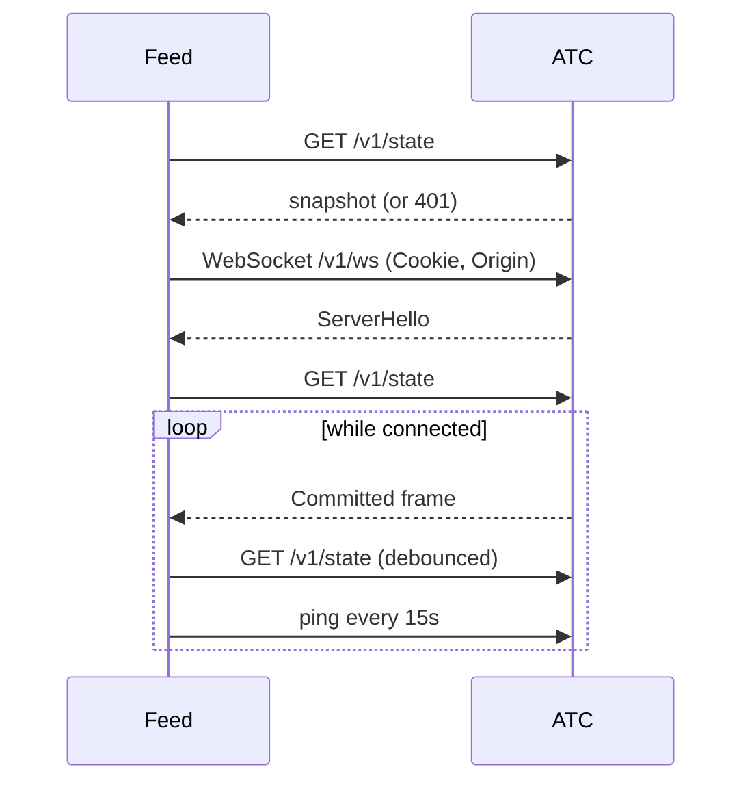
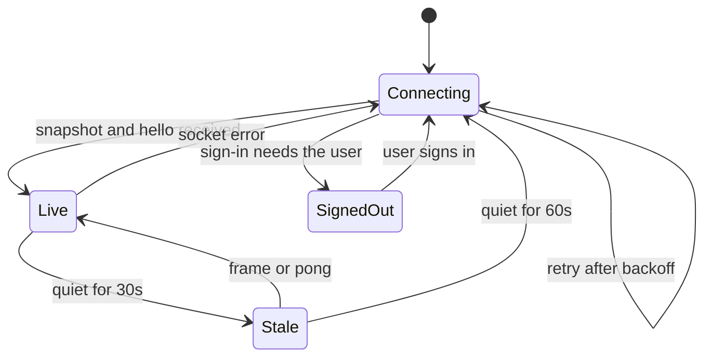

# Menubar App — Architecture

Last verified: 2026-11-13

ATC Menubar is a macOS menu bar app that lists the latest jobs from an ATC server. The menu bar item shows the number of running and queued jobs. Its popover groups jobs into Running, Queued, and Completed, and a click on a job opens its page on GitHub.

The app is a Swift package at `menubar/`. `swift build` compiles it and `build.sh` assembles and signs the `.app` bundle; there is no Xcode project.

| Target | Contents |
|--------|----------|
| `ATCKit` | Wire types, job ordering, status folding, OKLCH conversion. No UI, so it is unit-tested. |
| `ATCMenubar` | The app: `Feed` (connection), `Login` (sign-in), and the SwiftUI views. |

## Build and run

```bash
cd menubar
make run       # debug build, then launch
make test      # ATCKit tests
make install   # release build into /Applications
make dist TEAM_ID=XXXXXXXXXX   # signed, notarized zip in dist/
```

On first launch the popover asks for the server's URL, such as `https://atc.example.com`. The gear button edits it later. The URL is stored in the app's user defaults under `server`.

### Open at login

A copy in `/Applications` registers itself as a login item on its first launch, through `SMAppService`. It registers only once, so turning it off sticks. The **Open at login** checkbox behind the gear button, or System Settings → General → Login Items, changes it. A build run from `build/` never registers itself.

### Signed release

`make dist` signs the release build with the team's Developer ID certificate, the hardened runtime, and a secure timestamp. It then submits a zip to Apple's notary service, staples the ticket to the app, and writes `dist/ATCMenubar-<version>-macos.zip`.

It needs two things in the keychain: the Developer ID Application certificate for `TEAM_ID`, and notary credentials stored under the profile named by `NOTARY_PROFILE`. The app needs no entitlements.

## Data flow

The app treats each WebSocket frame as a signal to re-read `GET /v1/state`. It doesn't apply run and job events itself, so the server stays the only place that turns events into state. A burst of frames collapses into one fetch 300 ms after the first frame, plus at most one more for frames that arrive during it.



The first fetch exists to detect a 401, which a rejected WebSocket upgrade doesn't expose. The second fetch runs after `ServerHello`, when the subscription is open, so no event falls between the snapshot and the stream.

`Board.rows` orders the snapshot's jobs: running, queued, then completed, newest first in each lane. It keeps every unfinished job and fills up to 25 rows with the most recently completed ones.

## Sign-in

When the server runs `auth.mode = "github"`, `/v1/state` and `/v1/ws` need ATC's session cookie, and `/v1/ws` also needs an `Origin` header equal to the server's public origin. ATC issues the cookie only at the end of its browser OAuth flow, so the app runs that flow in a `WKWebView`:

1. `Login` loads `/v1/auth/github/login` in a web view.
2. GitHub authenticates the user and redirects to ATC's callback, which sets the session cookie.
3. When the web view lands on a page outside `/v1/auth`, `Login` reads the cookie from the web view's cookie store.
4. `Feed` puts the cookie in its `URLSession`, and sets `Origin` on the WebSocket request.

The web view keeps its GitHub session on disk. ATC rejects a session whose repository list is older than `repo_auth_ttl` (one hour by default) with a 401. On any 401 the app repeats the flow with the window hidden, which succeeds without input while GitHub still has the user signed in. If the hidden flow doesn't finish in 15 seconds, the app shows "Signed out" and waits for a click on **Sign in**.

A server with `auth.mode = "none"` never returns 401, so the app never opens the sign-in flow.

## Connection states

The dot in the popover's header follows the web UI's connection indicator. Clicking it reconnects at once in any state but Live, or signs in when signed out.



| Dot | State | Meaning |
|-----|-------|---------|
| Green | Live | The server answered in the last 30 seconds. |
| Yellow | Stale | Connected, but no frame or pong for 30 seconds. |
| Orange | Connecting | Disconnected and retrying. Backoff doubles from 1 second to 30. |
| Red | Signed out | Nothing retries until the user signs in. |
| Gray | No server | No server URL is set. |

ATC sends no frames while CI is idle, so the app pings every 15 seconds to tell a quiet server from a dead connection. Rows stay on screen while disconnected, until the server URL changes; the dot says how far to trust them.

## Design

The popover borrows the web UI's visual language from [`.impeccable.md`](../../.impeccable.md):

- Status colors are the same OKLCH tokens, dark and light. `ATCKit.srgb` converts them at run time so `Palette.swift` reads like the token table.
- Every status has a color and a symbol. The symbols are SF Symbols with the same shapes as the web UI's glyphs.
- A running job's symbol has a pulsing halo, and the connecting dot has an expanding ring. Both stop under Reduce Motion.
- Failed and timed-out rows keep a red tint.
- Durations use tabular digits.
